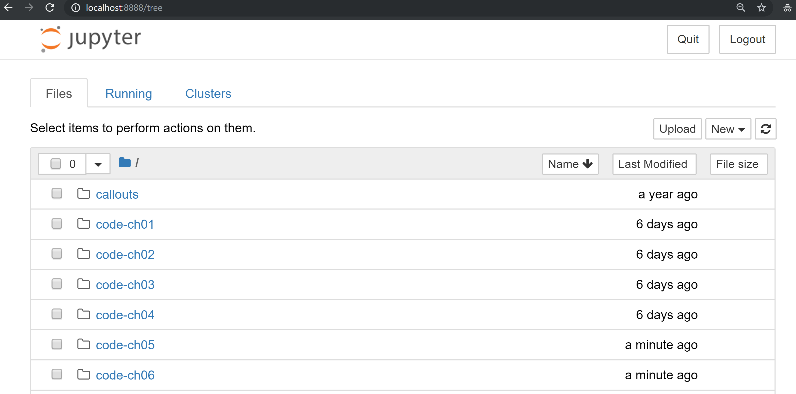

# [Programming Bitcoin](https://learning.oreilly.com/library/view/programming-bitcoin/9781492031482/)

### BY[ JIMMY SONG](https://github.com/jimmysong)

##### [O'Reilly Media, Inc.March 2019](https://learning.oreilly.com/library/publisher/oreilly-media-inc/)

# LICENSE

Repository for the book to be published by O'Reilly.

This book will be licensed under [CC-BY-NC-ND](https://creativecommons.org/licenses/by-nc-nd/4.0/legalcode) once the book is published.


## Setting Up


To get the most out of this book, you’ll want to create an environment where you can run the example code and do the exercises. Here are the steps required to set everything up:

### 1. Install Python 3.5 or higher on your machine:

Windows:		
[https://www.python.org/ftp/python/3.6.2/python-3.6.2-amd64.exe
](https://www.python.org/ftp/python/3.6.2/python-3.6.2-amd64.exe
)

macOS:		
[https://www.python.org/ftp/python/3.6.2/python-3.6.2-macosx10.6.pkg](https://www.python.org/ftp/python/3.6.2/python-3.6.2-macosx10.6.pkg)

Linux		
##### See your distro docs (many Linux distributions, like Ubuntu, come with Python 3.5+ preinstalled)

### 2. Install pip by downloading this script: [https://bootstrap.pypa.io/get-pip.py](https://bootstrap.pypa.io/get-pip.py).

### 3. Run this script using Python 3:
```bash
python3 get-pip.py
```		

### 4. Install Git. The commands for downloading and installing it are at [https://git-scm.com/downloads](https://git-scm.com/downloads).

### 5. Download the source code for this book:
```bash
git clone https://github.com/jimmysong/programmingbitcoin		
cd programmingbitcoin
```
		
### 6. Install virtualenv:
```bash
pip install virtualenv
```
### 7. Install the requirements:

Linux/macOS 
```bash
python3 -m venv .venv
source .venv/bin/activate
pip install -r requirements.txt
```

Windows

```powershell
virtualenv -p C:\PathToYourPythonInstallation\Python.exe .venv
.venv\Scripts\activate.bat
pip install -r requirements.txt
```	
another alternate way of doing this in windows is through the built in venv module:
```powershell
C:\programmingbitcoin> python -m venv .venv
C:\programmingbitcoin> .venv\Scripts\activate
C:\programmingbitcoin> pip install -r requirements.txt
```
### 8. Run Jupyter Notebook:

```bash
(.venv) $ jupyter notebook
```

You should see output like this:
```
[I 11:13:23.061 NotebookApp] Serving notebooks from local directory: /home/jimmy/programmingbitcoin
[I 11:13:23.061 NotebookApp] The Jupyter Notebook is running at:
[I 11:13:23.061 NotebookApp] http://localhost:8888/?token=f849627e4d9d07d2158e3fcde93590eff4a9a7a01f65a8e7
[I 11:13:23.061 NotebookApp] Use Control-C to stop this server and shut down all kernels (twice to skip confirmation).
```

Copy/paste this URL into your browser when you connect for the first time to login with a token:
```
http://localhost:8888/?token=f849627e4d9d07d2158e3fcde93590eff4a9a7a01f65a8e7
```

Your browser should open automatically, as shown below:



**For more information, see:** [Setting Up - Programming Bitcoin](https://learning.oreilly.com/library/view/programming-bitcoin/9781492031482/preface01.html#setting_up)
